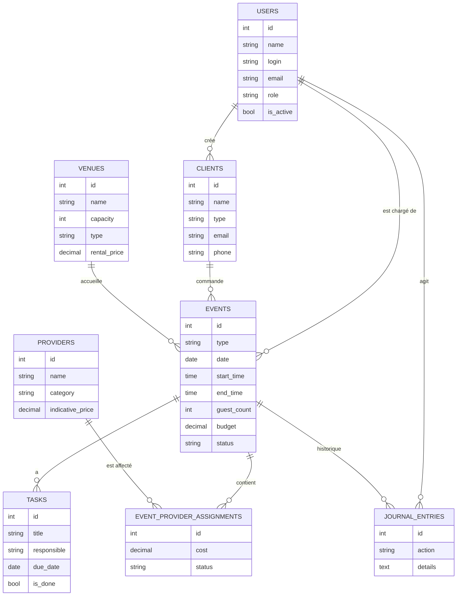

# Eventia

**Application web de gestion des événements d'une agence événementielle** (mariages, séminaires, conférences, concerts).

Eventia remplace les carnets et tableurs : elle centralise les clients, les lieux, les prestataires et les événements, empêche les doubles réservations, suit le budget et alerte quand quelque chose est en retard ou non confirmé.

> Projet de Licence 3. Modules **M1 à M7** réalisés, avec budget, tableau de bord et journal d'historique. Laravel 13 · Blade · SQLite/MySQL.

---

## Sommaire

1. [Fonctionnalités](#fonctionnalités)
2. [Pile technique](#pile-technique)
3. [Installation](#installation)
4. [Comptes de démonstration](#comptes-de-démonstration)
5. [Rôles et permissions](#rôles-et-permissions)
6. [Règles de gestion](#règles-de-gestion)
7. [Modèle de données](#modèle-de-données)
8. [Routes principales](#routes-principales)
9. [Architecture du code](#architecture-du-code)
10. [Tests](#tests)
11. [Sécurité](#sécurité)
12. [Accessibilité](#accessibilité)
13. [Dépannage](#dépannage)
14. [Documentation du projet](#documentation-du-projet)
15. [État d'avancement](#état-davancement)

---

## Fonctionnalités

| Module | Contenu |
|--------|---------|
| **M1 — Accès et utilisateurs** | Connexion par identifiant, 3 rôles, gestion des comptes (création, modification, activation/désactivation, suppression), limitation des tentatives de connexion |
| **M2 — Clients** | Particuliers et entreprises, recherche, filtre par type, pagination |
| **M3 — Lieux** | Lieux internes ou externes, capacité, prix de location |
| **M4 — Prestataires** | Traiteur, sonorisation, décoration, photographe, autre ; contact et prix indicatif |
| **M5 — Événements** | Création, modification, confirmation, annulation avec motif, statuts, recherche et filtres multiples |
| **M6 — Affectations** | Affectation de prestataires à un événement avec coût et statut de suivi |
| **M7 — Checklist** | Tâches par événement (responsable, échéance, fait ou non) et pourcentage d'avancement |
| **Budget** | Dépenses réelles, reste à dépenser, alerte de dépassement |
| **Tableau de bord** | Événements des 30 prochains jours, répartition par statut et par type, alertes |
| **Journal** | Historique des actions sur chaque événement (création, modification, changement de statut, annulation) |

### Cycle de vie d'un événement

```
brouillon ──confirmer──▶ confirmé ──(date passée, automatique)──▶ terminé
    │                        │
    └───────annuler──────────┴──▶ annulé  (motif obligatoire, 5 caractères minimum)
```

Les événements confirmés dont la date est passée passent automatiquement à « terminé » à l'ouverture de la liste des événements.

### Alertes du tableau de bord

- Prestataire **non confirmé** pour un événement confirmé qui a lieu dans **15 jours ou moins**
- **Dépassement de budget** sur un événement non annulé
- **Tâche en retard** (échéance dépassée et non terminée)

---

## Pile technique

| Élément | Choix |
|---------|-------|
| Langage | PHP 8.4 |
| Framework | Laravel 13 |
| Vues | Blade (rendu côté serveur, sans framework JavaScript) |
| Base de données | SQLite par défaut, MySQL possible |
| Tests | PHPUnit via `php artisan test` |
| Architecture | Monolithe MVC avec requêtes de validation dédiées (`FormRequest`), middleware et service de journal |

---

## Installation

### Prérequis

- PHP **8.4 ou plus** avec les extensions `pdo_sqlite` (ou `pdo_mysql`), `mbstring`, `xml`
- [Composer](https://getcomposer.org)
- Git

### Étapes

```bash
# 1. Récupérer le projet
git clone <url-du-depot>
cd <dossier-du-projet>

# 2. Installer les dépendances
composer install

# 3. Créer le fichier d'environnement et la clé de l'application
cp .env.example .env          # sous Windows PowerShell : copy .env.example .env
php artisan key:generate

# 4. Créer la base SQLite (si le fichier n'existe pas) puis les tables et les données de démonstration
touch database/database.sqlite   # sous Windows PowerShell : New-Item database/database.sqlite
php artisan migrate --seed

# 5. Lancer le serveur
php artisan serve
```

Ouvre ensuite **http://127.0.0.1:8000** et connecte-toi avec un [compte de démonstration](#comptes-de-démonstration).

### Utiliser MySQL à la place de SQLite

Dans `.env`, remplace la configuration de base de données :

```env
DB_CONNECTION=mysql
DB_HOST=127.0.0.1
DB_PORT=3306
DB_DATABASE=eventia
DB_USERNAME=root
DB_PASSWORD=
```

Crée la base `eventia`, puis relance `php artisan migrate --seed`.

### Commandes utiles

| Commande | Rôle |
|----------|------|
| `php artisan serve` | Lance le serveur de développement |
| `php artisan migrate:fresh --seed` | Réinitialise la base avec les données de démonstration (**efface tout**) |
| `php artisan optimize:clear` | Vide les caches (configuration, routes, vues) |
| `php artisan route:list` | Liste toutes les routes |
| `php artisan test` | Lance les tests automatisés |

---

## Comptes de démonstration

On se connecte avec l'**identifiant** (et non l'email). L'identifiant est insensible à la casse.

| Nom | Identifiant | Email | Mot de passe | Rôle |
|-----|-------------|-------|--------------|------|
| Admin Eventia | `admin` | admin@eventia.fr | `admin123` | Administrateur |
| Marie Dupont | `marie.dupont` | marie.dupont@eventia.fr | `charge123` | Chargé d'événements |
| Pierre Martin | `pierre.martin` | pierre.martin@eventia.fr | `consult123` | Consultant |
| Jean Inactif | `jean.inactif` | jean.inactif@eventia.fr | `inactive123` | Consultant, **compte désactivé** (connexion refusée) |

> ⚠️ Ces comptes servent uniquement à la démonstration. Change les mots de passe, ou supprime-les, avant tout déploiement réel.

Le jeu de données de démonstration contient aussi des clients, des lieux et des prestataires.

---

## Rôles et permissions

| Action | Administrateur | Chargé d'événements | Consultant |
|--------|:---:|:---:|:---:|
| Voir le tableau de bord | ✅ | ✅ | ✅ |
| Consulter clients, lieux, prestataires, événements | ✅ | ✅ | ✅ |
| Créer / modifier / supprimer clients, lieux, prestataires | ✅ | ✅ | ❌ |
| Créer / modifier / confirmer / annuler un événement | ✅ | ✅ | ❌ |
| Affecter des prestataires, gérer la checklist | ✅ | ✅ | ❌ |
| Gérer les utilisateurs | ✅ | ❌ | ❌ |

Le contrôle est fait côté serveur par le middleware `permission` (par exemple `permission:administrateur,charge_evenements`). Le menu latéral n'affiche que ce qui est accessible au rôle. Un accès interdit renvoie une erreur 403.

---

## Règles de gestion

| Règle | Description | Où |
|-------|-------------|----|
| **RG3** | Pas de double réservation : un lieu ne peut pas accueillir deux événements non annulés qui se chevauchent le même jour | `StoreEventRequest`, `UpdateEventRequest` |
| **RG4** | Le nombre d'invités ne peut pas dépasser la capacité du lieu | `StoreEventRequest`, `UpdateEventRequest` |
| **RG10** | Un prestataire ne peut pas être affecté à deux événements non annulés qui se chevauchent | `EventProviderAssignmentController` |
| **RG12** | Dépenses réelles = coûts des affectations non annulées + prix de location du lieu | `Event::realExpenses()` |
| **RG13** | Progression de la checklist = tâches faites / tâches totales, en pourcentage | `Event::checklistProgress()` |
| **RG14** | Alertes : prestataire non confirmé à moins de 15 jours, budget dépassé, tâche en retard | Tableau de bord |
| **RG15** | Suppression refusée si l'élément est lié à d'autres données (utilisateur lié à des clients, client, lieu ou prestataire liés à des événements) | Contrôleurs concernés |
| **RG16** | Journal d'historique des actions sur les événements | `JournalService` |
| **RG17** | Lecture pour tous les utilisateurs connectés, écriture réservée selon le rôle | Middleware `permission` |

Contrôles de saisie d'un événement : date non passée, heure de fin après l'heure de début, nombre d'invités d'au moins 1, budget positif ou nul, client, lieu et chargé d'événements existants.

Un administrateur ne peut pas supprimer ni désactiver son propre compte.

---

## Modèle de données



Valeurs possibles :

- **Rôle utilisateur** : `administrateur`, `charge_evenements`, `consultant`
- **Type de client** : `particulier`, `entreprise`
- **Type de lieu** : `interne`, `externe`
- **Catégorie de prestataire** : `traiteur`, `sonorisation`, `décoration`, `photographe`, `autre`
- **Type d'événement** : `mariage`, `séminaire`, `conférence`, `concert`, `autre`
- **Statut d'événement** : `brouillon`, `confirmé`, `terminé`, `annulé`
- **Statut d'affectation** : `a_contacter`, `contacte`, `confirme`, `annule`

---

## Routes principales

Toutes les routes, sauf la connexion, exigent d'être connecté avec un compte actif.

| Ressource | Routes |
|-----------|--------|
| Authentification | `GET/POST /login`, `POST /logout` |
| Tableau de bord | `GET /dashboard` (et `/` qui y redirige) |
| Clients | `/clients` (liste, création, fiche, modification, suppression) |
| Prestataires | `/providers` (idem) |
| Lieux | `/venues` (idem) |
| Événements | `/events` (idem) + `PATCH /events/{event}/confirm`, `POST /events/{event}/cancel` |
| Affectations | `POST/PUT/DELETE /events/{event}/assignments[/{assignment}]` |
| Tâches | `POST/PUT/DELETE /events/{event}/tasks[/{task}]`, `PATCH .../toggle` |
| Utilisateurs | `/users` (administrateur uniquement) |

La liste complète s'obtient avec `php artisan route:list`.

---

## Architecture du code

```
app/
├── Http/
│   ├── Controllers/
│   │   ├── Access/        AuthController, UserController
│   │   ├── Clients/       ClientController
│   │   ├── Venues/        VenueController
│   │   ├── Providers/     ProviderController
│   │   └── Events/        EventController, EventProviderAssignmentController, TaskController
│   ├── Middleware/        CheckPermission, EnsureUserIsActive, SecurityHeaders
│   └── Requests/          Validation par module (Access, Clients, Venues, Providers, Events)
├── Models/                User, Client, Venue, Provider, Event,
│                          EventProviderAssignment, Task, JournalEntry
└── Services/              JournalService
bootstrap/app.php          Alias des middleware (active, permission) et en-têtes de sécurité
database/
├── factories/             Données de test pour chaque modèle
├── migrations/            Schéma complet
└── seeders/               Données de démonstration
resources/views/
├── layouts/app.blade.php  Mise en page avec menu latéral selon le rôle
├── access/                Connexion, tableau de bord, utilisateurs
└── clients/ venues/ providers/ events/   Liste, formulaire, fiche
routes/web.php             Toutes les routes de l'application
tests/Feature/             Tests fonctionnels par module
docs/                      Plan du module M1 et décisions d'architecture (ADR)
```

Principes suivis :

- **Un module, un dossier** de contrôleurs et de requêtes de validation
- **Validation hors des contrôleurs**, dans des `FormRequest` avec messages en français
- **Règles métier proches des données** : calculs de budget et de progression dans le modèle `Event`
- **Sécurité en couches** : middleware `auth`, `active` puis `permission`

---

## Tests

```bash
php artisan test
```

Les tests utilisent des factories et couvrent chaque module :

| Fichier | Sujet |
|---------|-------|
| `AuthenticationTest` | Connexion, déconnexion, comptes inactifs |
| `UserManagementTest` | Gestion des utilisateurs et droits d'accès |
| `ClientManagementTest` | Clients : CRUD, recherche, filtres, RG15 |
| `VenueManagementTest` | Lieux |
| `ProviderManagementTest` | Prestataires |
| `EventManagementTest` | Événements : validation, RG3, RG4, statuts, annulation |
| `EventProviderAssignmentTest` | Affectations et RG10 |
| `TaskManagementTest` | Checklist |
| `JournalTest` | Journal d'historique |

---

## Sécurité

| Mesure | Mise en œuvre |
|--------|---------------|
| Mots de passe | Hachés (bcrypt) via le cast du modèle |
| Identifiant | Recherche insensible à la casse |
| Force brute | 5 tentatives de connexion par 60 secondes (`RateLimiter`) |
| Comptes désactivés | Refusés à la connexion, et déconnectés si désactivés en cours de session |
| Session | Régénération après connexion ; invalidation et nouveau jeton à la déconnexion |
| CSRF | `@csrf` sur tous les formulaires |
| XSS | Échappement Blade `{{ }}` |
| Injection SQL | Eloquent et requêtes paramétrées |
| Contrôle d'accès | Middleware `auth`, `active`, `permission` côté serveur |
| En-têtes HTTP | `X-Content-Type-Options`, `X-Frame-Options: DENY`, `X-XSS-Protection`, `Referrer-Policy`, `Content-Security-Policy` |

---

## Accessibilité

Cible : **WCAG 2.2 niveau AA**.

- Lien d'évitement « Aller au contenu principal »
- Attributs ARIA sur la navigation, les formulaires et les alertes
- Champs associés à leurs libellés (`for` / `id`), champs obligatoires signalés avec `aria-required`
- Focus visible (`:focus-visible`) et navigation complète au clavier
- Structure sémantique (`nav`, `main`, `header`, `aside`, en-têtes de tableau avec `scope`)
- Affichage adapté au mobile et au bureau

---

## Dépannage

| Problème | Solution |
|----------|----------|
| `Your Composer dependencies require a PHP version ">= 8.4.1"` | Installe PHP 8.4 ou plus (`php -v` pour vérifier) |
| `No application encryption key has been specified` | Lance `php artisan key:generate` |
| `could not find driver` ou `Database file does not exist` | Active l'extension `pdo_sqlite` et crée `database/database.sqlite` |
| `no such table` | Lance `php artisan migrate --seed` |
| Une modification n'apparaît pas | Lance `php artisan optimize:clear` |
| `Cannot use ... as ... because the name is already in use` | Une classe est importée deux fois : supprime la ligne `use` en double dans le fichier indiqué |
| Impossible de se connecter | Utilise l'**identifiant** (par exemple `admin`) et non l'email, et vérifie que le compte est actif |
| Réinitialiser toutes les données | `php artisan migrate:fresh --seed` (efface tout) |

---

## Documentation du projet

- `docs/modules/m1-acces-utilisateurs.md` : plan d'implémentation du module M1
- `docs/adr/ADR-003-acces-au-journal.md` : décision sur l'accès au journal
- `docs/adr/ADR-004-dernier-administrateur-et-amorcage.md` : protection du dernier administrateur et création du premier compte

---

## État d'avancement

### Terminé

- M1 à M7 : accès et utilisateurs, clients, lieux, prestataires, événements, affectations, checklist
- Budget et alertes de dépassement, tableau de bord, journal d'historique
- Tests automatisés pour chaque module
- Sécurité (OWASP) et accessibilité (WCAG 2.2 AA)

### À faire

- **Protection du dernier administrateur** (ADR-004) : empêcher de désactiver ou rétrograder le dernier administrateur actif, et créer le premier compte par une commande `artisan` plutôt que par le seeder
- **Journal** : page de consultation dédiée (aujourd'hui, l'historique s'affiche dans la fiche de chaque événement)
- **M10 — Calendrier** des événements
- **M11 — Export** PDF et tableur

### Difficultés rencontrées

- **Compatibilité PHP** : Laravel 13 utilise des syntaxes de PHP 8.4 (property hooks), donc PHP 8.4 est obligatoire
- **Environnement de développement sous Windows** : configuration de PHP, de Composer et des extensions

---

## Mise en ligne (lien public) avec Render

GitHub Pages ne peut pas héberger Eventia (PHP + base de données). Le site est donc hébergé sur [Render](https://render.com) (offre gratuite), qui se met à jour automatiquement à chaque push GitHub.

1. Pousse le projet sur GitHub (branche `develop`).
2. Sur render.com, connecte-toi avec ton compte GitHub.
3. **New → Blueprint**, choisis ton dépôt, puis **Apply**. Render lit `render.yaml`, construit l'image à partir du `Dockerfile` et démarre le site.
4. Le lien public apparaît en haut de la page du service, de la forme `https://eventia-xxxx.onrender.com`. Tu peux l'envoyer à n'importe qui.

Ensuite, chaque push sur `develop` relance les tests (GitHub Actions) puis, s'ils passent, Render redéploie le site automatiquement.

Limites de l'offre gratuite :

- Le site **s'endort après environ 15 minutes sans visite** : la première ouverture suivante prend environ une minute.
- Le disque est **temporaire** : à chaque redémarrage ou redéploiement, la base est recréée avec les données de démonstration (`SEED_DEMO=true`). Les données saisies sont perdues. Pour une base durable, passe à une offre payante avec disque persistant ou utilise MySQL.

Comptes de démonstration : voir la section [Comptes de démonstration](#comptes-de-démonstration).

---

## Image Docker (GitHub Container Registry)

Le fichier `.github/workflows/ci-cd.yml` s'exécute à chaque push sur `main` ou `develop` (et sur chaque pull request) :

1. **Tests** : installe PHP 8.4 et les dépendances, puis lance `php artisan test`.
2. **Image Docker** (si les tests passent, sur un push uniquement) : construit l'image décrite dans le `Dockerfile` et la publie sur GitHub Container Registry, à l'adresse `ghcr.io/<propriétaire>/<dépôt>` en minuscules. Aucun secret à créer : le workflow utilise le `GITHUB_TOKEN` fourni par GitHub.

Étiquettes publiées : `latest` (branche par défaut), le nom de la branche (`develop`, `main`) et `sha-<commit>`.

### Lancer l'image sur un serveur ou en local

```bash
# 1. Générer une clé d'application (à garder, ne pas la republier)
docker run --rm ghcr.io/<propriétaire>/<dépôt>:latest php artisan key:generate --show

# 2. Lancer l'application (la base SQLite est conservée dans le volume eventia-data)
docker run -d --name eventia -p 8080:80 \
  -e APP_KEY="base64:...la clé générée..." \
  -e APP_URL="http://localhost:8080" \
  -e SEED_DEMO=true \
  -v eventia-data:/data \
  ghcr.io/<propriétaire>/<dépôt>:latest
```

L'application est alors disponible sur http://localhost:8080. Au démarrage, le conteneur exécute `php artisan migrate --force`.

| Variable | Rôle |
|----------|------|
| `APP_KEY` | **Obligatoire.** Clé de chiffrement de l'application |
| `APP_URL` | Adresse publique de l'application |
| `SEED_DEMO` | `true` pour créer les comptes et données de démonstration quand la base est vide (à retirer en production réelle) |
| `PORT` | Port d'écoute si l'hébergeur l'impose (par défaut 80) |
| `DB_DATABASE` | Chemin du fichier SQLite (par défaut `/data/database.sqlite`) |

Si l'image est privée, connecte-toi d'abord : `docker login ghcr.io` (utilise un jeton personnel avec la permission `read:packages`). Tu peux aussi la rendre publique dans les paramètres du paquet sur GitHub.

> ⚠️ Avec `SEED_DEMO=true`, les mots de passe de démonstration sont connus de tous : ne l'active pas sur un site réellement exposé.
